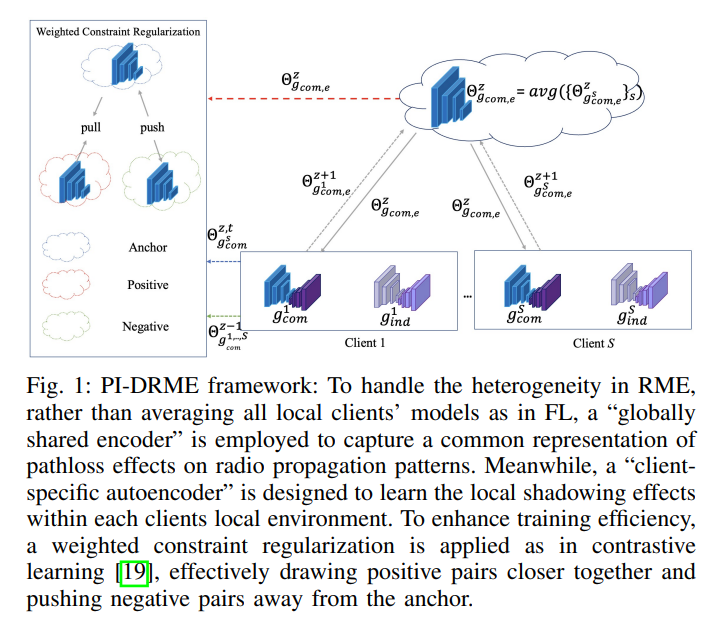
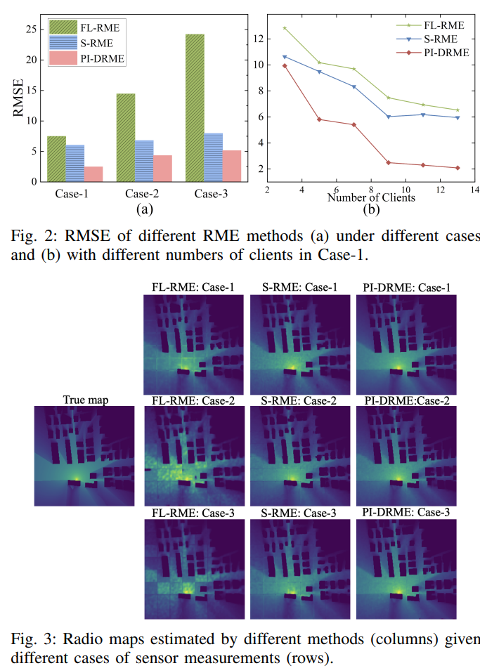

# Radio Map Based on Physical Inspiration for Distributed Wireless Map Estimation [with Python Code]

To achieve panoramic perception of spectrum coverage in complex wireless environments, data-driven learning methods have recently been introduced into Radio Map Estimation (RME). Although existing deep learning-based methods perform RME with spectral measurements collected from sensors scattered within an interest area, they rely on centralized data fusion centers, which raises critical issues of data privacy leakage and high communication loads. Federated Learning (FL) enhances data security and communication efficiency in RME by allowing multiple clients to collaborate for model training without directly sharing local data. However, the performance of federated RME may be hindered due to the heterogeneity of tasks among clients (due to their unavailability or inaccurate environmental information). To address this gap, this paper proposes a physically-inspired distributed RME solution that operates under the absence of environmental information. The main idea is to develop a new distributed RME framework that leverages domain knowledge of radio propagation models as well as a novel distributed learning approach that splits the entire RME model into two modules. The global autoencoder module is shared among clients to capture the impact of common path loss on radio propagation patterns, while the client-specific autoencoder module focuses on learning individual features from local building distributions resulting from unique shadow effects. Simulation results show that our proposed method outperforms benchmark methods in terms of achieving higher performance.
Introduction In future smart wireless systems, accurate and panoramic spectrum perception of the surrounding wireless environment at different locations is crucial. Besides traditional spectrum perception techniques in cognitive radio [1]-[3], Radio Map Estimation (RME), or spectrum mapping, plays a vital role in estimating the geographical distribution of spectrum coverage [4]-[6]. RME depicts the spatial distribution of signal power across various frequency bands, typically represented as heatmap images where power spectral density (PSD) is plotted as a function of position, frequency, and time [7]. RME is valuable for a range of applications, including post-disaster network reconstruction [8], unmanned aerial vehicle path planning [9], and dynamic spectrum allocation [10].
Most existing RME methods operate in a centralized manner, requiring all distributed sensors within the target area to transmit their spectrum data and geographic information to a single central node for training and evaluation. However, this centralized approach faces challenges in real-world wireless environments due to the massive communication load, which may prevent the central node from collecting data from all sensors. Additionally, privacy concerns may prevent sensors from sharing their local spectrum data or location details with the central node. Furthermore, the lack of radio measurement data leads to the notorious overfitting problem in centralized approaches, which often requires complex deep learning models to handle high-dimensional data. To protect privacy and improve communication efficiency, federated learning (FL) has been used in RME through multiple clients collaborating without sharing local data during model training [16]. However, due to the inaccurate or unavailable environmental information among clients in practice, the learning performance of FL-based RME can be degraded by task heterogeneity issues between clients. Moreover, each target area has unique geographical patterns, leading to data and model heterogeneity between regions [17], especially when building information is not available, making this issue more severe.
To address these challenges, we propose a Physical-Intuitionistic Distributed Radio Map Estimation (PI-DRME) framework leveraging the fact that different wireless channel models have distinct propagation characteristics and thus affect the received signal power differently. With such domain knowledge, under the PI-DRME framework, we decouple the entire deep learning model into different modules, allowing clients to collaboratively train their common modules while individually training their client-specific modules. In this way, our method can effectively capture representations of global propagation features between all clients as well as local propagation features corresponding to individual clients. The main contributions of PI-DRME are summarized as follows: 1) We propose an interpretable PI-DRME architecture using the logarithmic distance path loss model to guide the global shared autoencoder in learning the common radio propagation effects in free space among clients. At the same time, each client also trains a dedicated local autoencoder to learn the client-specific propagation effects in the local shadow environment. 2) We develop a distributed RME algorithm that works in heterogeneous scenarios by introducing physical-intuitionistic regularization to balance the representation capabilities of deep neural network models in learning both the common and individual radio propagation features. 3) We design and run comprehensive simulations to test our PI-DRME and evaluate its performance compared to existing benchmarks. Our results show that our method outperforms FL and standalone RME methods in terms of accuracy in wireless map reconstruction.
Conclusion This paper proposes a Physically-Informed Distributed Radio Map Estimation (PI-DRME) framework, leveraging domain knowledge of radio propagation behavior to address the heterogeneity issues in distributed RME. Our key innovation is strategically decoupling deep learning models into two modules: a shared module that captures universal path loss features through collaborative training, and a client-specific module that learns local shadow effects in the local environment. Simulation results demonstrate that our PI-DRME achieves ideal learning accuracy for distributed RME without environmental information.

## Images

<!-- PAYMENT_BLOCK -->

## Get this dataset

- Payment link (Stripe): [Buy now](https://buy.stripe.com/3cs8yP7sY87d0vu9AB)
- Payment QR code: 

<!-- /PAYMENT_BLOCK -->
